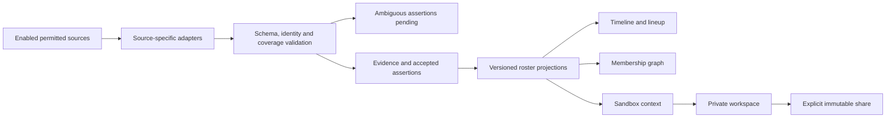

# Opval roster-first product and engineering plan

> Status: scope confirmed; detailed plan only. Implementation, deployment, purchases, account creation, and provider outreach are not authorized by this document.
> Date: 17 November 2026 (Australia/Brisbane).
> Evidence: source-derived fallback, verified at commit `a9f520d0d98360b4970bd4124116ccee05c1373e`. GitNexus and Context7 tools were unavailable. No graph/PDG findings are claimed. Current official web documentation supplements repository evidence.
> Evidence provenance schema 2; global dirty digest `0a9c85780067d9afcd0764f307b60891e3cee927ee11eaeb5ec7826d10fd82cd`; 26 sorted cited paths in §11; only this generated plan path is excluded.

## 1. Objective

Make Opval a trustworthy, public reference for VALORANT team rosters: see today's team, understand how it changed, explore its history, and construct clearly hypothetical alternatives. Preserve Opval's visual identity. Free predictions become secondary.

### Confirmed product decisions

| Area | Agreed scope |
| --- | --- |
| Audience | Fans following teams, roster changes, and history; focused roster product rather than a full esports encyclopedia. |
| Coverage | All current VCT international league organizations across Americas, EMEA, Pacific, and China. Their VALORANT histories from inception, including earlier regional play, staff, substitutes, and bench periods where evidenced. Historical gaps are explicitly acceptable. |
| Organization boundaries | Keep predecessor organizations distinct unless continuity is documented. Former/non-VCT teams may appear as contextual lineage nodes; comprehensive coverage of their independent histories is not a launch requirement. |
| Data | Strictly free sources, permitted APIs/feeds/downloads/submissions and explicitly permitted extraction. No VLR scraping, unofficial scraper proxies, or access-control workarounds. |
| Operations | Almost no routine manual work. Conservative automatic publication; ambiguous records stay pending. Daily update target for supported sources, with visible freshness. |
| Reporting | Optional, off by default. Only approved structured reporting feeds can publish automatically. Other submissions stay pending; no fabricated probabilities. |
| Launch interactions | Timeline, lineup-at-date, evidence panel, comparisons, membership/overlap graph, and hypothetical roster sandbox are all required. |
| Access | Anonymous browsing. Existing accounts support private cloud saves and explicitly created, revocable, unlisted, read-only snapshot links. |
| Commercial/AI | Noncommercial first release; no paid AI dependency. Free data does not imply zero hosting cost or an unrestricted production licence. |
| Gameplay | Preserve records; move gameplay to Play. Betting mechanics may change. New predictions may pause if no suitable permitted feed exists. |

### Product success tasks

A fan can answer: What is known about this team's current roster? What changed? Who belonged to it at a selected date? Which players overlapped? What evidence supports that answer? What would my hypothetical lineup look like? Every answer distinguishes known information from missing or uncertain information.

## 2. Current behaviour

All findings below are [verified], source-derived at the pinned commit.

| Evidence | Behaviour and implication |
| --- | --- |
| `apps/call/src/App.jsx:19` | Every route is inside `GameProvider`; `/` is the match page, `/roster` is secondary. Moving navigation alone will not decouple public browsing. |
| `apps/call/src/components/Shell.jsx:110` | Shell consumes game state; account/recovery checks gate non-Legal routes, followed by a session Play splash. HUD includes game points/credits. |
| `apps/call/src/pages/Roster.jsx:40` | Fetches transfers/contracts/events/status/unresolved together; requires game context, displays transfer guesses, and uses local team/filter state. A failure in one request currently fails the combined load. |
| `apps/call/src/lib/account.js:20` | `useAccount` combines session management, game-save adoption, background uploads, wallet refresh, and game actions. It is not a generic roster-save hook. |
| `apps/call/worker/accounts.js:245` | `putSave` rejects changes outside authoritative game actions. Reusing `/api/save` for scenarios would violate its existing contract. |
| `worker/feed/roster.js:28` | GCD snapshots and checks exist. Identity is normalized handle plus league; two repeated observations create inferred change events. Initial snapshots are baselines. |
| `worker/feed/roster.js:93` | Events record first-observed and confirmation times, not proven effective membership dates. Transfer-out rows also require old/new-row review before historical migration. |
| `scripts/feed/roster.py:66` | GCD parser excludes coaching and non-active rows; existing ingestion cannot deliver the confirmed scope unchanged. |
| `.github/workflows/feed.yml`, `scripts/feed/run.js:33`, `scripts/feed/roster.py:132` | Match and transfer acquisition use VLR scraping. Workflow also collects GCD through published sheet HTML. Public availability is not a recorded reuse approval. |
| `apps/call/worker/index.js:42` | Worker cron dispatches the feed workflow; stopping a single scheduled workflow trigger does not fully remove ingestion. |
| `apps/call/worker/weeklyBingo.js:55`, `apps/call/worker/transferBets.js:10` | Gameplay settlement consumes existing roster events/checks. Historical backfills must not generate new scoring events. |
| `apps/call/wrangler.jsonc`, `README.md` | Existing app uses a Worker and D1 shared with VFL; Opval owns migrations. `shared/` is a cards-val submodule, not an ordinary edit target. |

## 3. Relevant architecture and research

### 3.1 Retain the existing application platform

[inferred] Retain React/Vite, the existing Worker, and D1. Do not add Supabase, a graph database, an SSR framework migration, or an LLM to deliver these requirements. Canonical relational facts can produce both timeline and graph projections.

Separate four responsibilities:

1. Public roster reads: source-approved facts, coverage, derived timelines, and graphs.
2. Account session: authentication/recovery independent of game state.
3. Private workspace: saved scenarios/comparisons and immutable share payloads.
4. Play: existing game state, wallet, settlements, and any approved future match feed.

[verified] `worker/feed/routes.js:40` bearer-guards ingestion, while `apps/call/worker/index.js:69` exposes roster reads ahead of account routes. Preserve the security boundary while adding versioned roster endpoints.

### 3.2 What the supplied research supports

The [roster specification](/Users/dimas/Downloads/temporal_roster_timelines_agent_spec.md) proposes synchronized tenure timelines, lineage, contract context, filters, and hypothetical rosters. It is a design proposal, not a validated dataset or a licence. Its example future rosters, contract claims, exact map counts, rumor percentages, decay formula, and league rules must not seed production facts.

Bruce Liu's *Beyond Taking Turns in Human–AI Interaction* describes parallel communication, proactive participation, and persistent shared spaces: [supplied dissertation](/Users/dimas/Downloads/qt28d8b7wd.pdf), printed pp. 3–6, 141–142. The dissertation treats their combination as future research; Opval applications below are [inferred] design hypotheses.

The reported studies concern conversation and video creation, not esports. They support testing user control and contextual assistance, not claiming a proven engagement or speed gain for roster exploration. “Non-turn-based” here does not mean changing the game's rules.

### 3.3 Source feasibility, checked 17 November 2026

| Candidate | Useful evidence | Selection decision / gate |
| --- | --- | --- |
| Official team, player, and organizer announcements; direct submissions | Membership changes, effective dates when explicitly stated, official registrations. | Foundation for independent facts. Automate only permitted structured access or reliable approved extraction. Reproduce factual summaries and links, not full articles or unlicensed images. Direct partnerships are possible future arrangements, not existing rights. |
| [Riot Global Contract Database](https://competitiveops.riotgames.com/en-US/VALORANT) | Official current roster, coaching staff, team affiliation, contract-end information. | Best candidate for current registration/contract observations. Verify collection and reuse terms before enabling its adapter. A current row does not prove a historic join date or a starting five. |
| [PandaScore plan reference](https://developers.pandascore.co/docs/plan-reference), [getting started](https://developers.pandascore.co/docs/getting-started) | Free-plan reference entities and fixtures; tournament participation may help locate roster observations. Detailed statistical endpoints have additional plan requirements. | Candidate enrichment, not the source of truth for tenure. Verify actual free VALORANT fields, pagination, regions, archive depth, attribution and permitted display with an account-level sample. Do not assume every history endpoint is free. |
| [PandaScore terms](https://www.pandascore.co/terms-and-condition) | Restrictions include odds-related products, raw redistribution, attribution and termination obligations. | Gate the exact combined Opval use, including shares and gameplay. Preserve separate provenance and retention rules for licensed observations; do not export a raw provider mirror. |
| [GRID Open Access](https://grid.gg/riot-open-access/) | Official VALORANT and LoL data for noncommercial learning/experimentation, delayed access, no betting/gambling. Commercial licensing is separate. | Useful prototype candidate; not established as unrestricted free public-production permission. Verify use, storage, history and fields before selecting. Noncommercial alone is insufficient. |
| [Liquipedia API](https://liquipedia.net/api) | Structured transfers and other esports data; indexed official page describes replica and virtual-currency-gambling exclusions, conditional free access and current enterprise-oriented availability. | Exclude from the baseline plan. Direct page returned 403; findings come from indexed official text. Reconsider only with explicit applicable permission and a sustainable free offer. Do not fall back to HTML scraping. |
| Paid vendors / premium history | Potentially broader licensed coverage. | Outside the confirmed free-data scope. No purchases or outreach proposed for this phase. |
| Community/open datasets | Potential additional historical leads. | Accept only with traceable provenance and compatible licence; a public repository or “free API” may merely repackage unauthorized scraping. |

[inferred] No researched route proves complete, free, unattended inception-to-present coverage. The realistic operating model is source adapters plus a conservative evidence store, with permanently visible gaps where automation cannot establish facts. Historical backfill will be opportunistic, not a promised completion date.

### 3.4 Source approval checklist

Before any adapter runs, record: publisher, official documentation/terms URL, checked date, allowed access method, permitted fields and display, storage/retention, attribution, caching/rate limits, derivative/share rights, restrictions on the whole product, and enabled/disabled decision. Asset permission is separate from data permission.

If terms are unclear, leave the adapter disabled. Robots directives and a technically working endpoint do not establish reuse rights. Never use logged-in browser cookies, private scrim data, or undocumented workarounds to fill coverage. No provider account or key was created during planning.

## 4. GitNexus findings — source-derived fallback

GitNexus was unavailable; no index refresh or graph traversal ran. Direct source reads and bounded `rg` searches establish these dependencies; they are not a claim of exhaustive graph analysis.

| Primary area | Direct dependencies / impact |
| --- | --- |
| `App` | `Shell`, route components, `GameProvider`; moving the provider requires removing informational components' game-context imports. |
| `Shell` | `useGame`, account gate, account form, match dashboard, bingo update hook, wallet HUD; split public and Play responsibilities. |
| `useAccount` | Session endpoints, `/api/save`, wallet events, game action requests; extract session responsibilities while keeping gameplay save semantics. |
| `handleAccounts` | Session lookup, authoritative game saves and actions, bingo, transfer bets, public profile; add workspace handling without broadening game permissions. |
| `ingestContracts` | Source snapshot/candidate/event tables, roster reads, bingo and transfer settlement; new history must be isolated from live scoring. |

Related tests located: `test/opvalAccounts.test.js`, `test/opvalCron.test.js`, `test/weeklyBingo.test.js`, `test/transferBets.test.js`, `test/feedRoutes.test.js`, `test/feedStore.test.js`, `scripts/feed/test_roster.py`. Existing Node tests use `test/helpers/d1Shim.js`; it explicitly enumerates migrations.

## 5. Statement-level constraints — no PDG layer

These are [verified] source observations, not PDG edges:

- `Shell` checks account state before rendering the outlet (`Shell.jsx:129`). Public rendering must precede and remain independent of optional session loading/failure.
- `useAccount` loads `/api/save` after sign-in (`account.js:40`) and refreshes it on visibility/wallet changes (`account.js:69`). Reuse of this hook unchanged would initialize game state on a roster page.
- `putSave` compares submitted state to authoritative state (`accounts.js:245`). Do not loosen this validation to accommodate scenarios.
- `ingestContracts` refuses empty/ambiguous input, records content-hashed snapshots, and uses a two-observation threshold (`roster.js:29`, `:40`, `:91`). That threshold proves persistence of a source change, not independent corroboration.
- `ingestContracts` writes snapshots, candidates, contracts and events through multiple awaits. New ingestion must handle retries and interruption explicitly; content deduplication alone does not prove complete publication.
- `getRoster` returns public cacheable data (`roster.js:6`, `:108`). Private workspaces and revocable shares must not inherit that cache policy.
- Cron triggers dispatch and settlement separately (`index.js:59`). A cutover must explicitly disable disallowed acquisition and new dependent game actions while preserving existing records.

## 6. Proposed changes

Everything in this section is a proposed implementation, not completed work. New paths/entities/routes are explicitly proposed names; existing symbols referenced above were source-verified.

### 6.1 Navigation and page design

| Proposed route | Purpose |
| --- | --- |
| `/` | Current roster directory and recent confirmed changes; league/search filters, coverage/freshness strip. Teams with missing data still appear with a clear empty state. |
| `/teams/:teamId/:slug?` | Team overview, current known membership, timeline/lineup/evidence workspace, graph and sandbox entry. Stable ID is authoritative; slugs can change. |
| `/players/:personId/:slug?` | Known career intervals, statuses, sources, and team links. Clearly mark career segments outside tracked-team coverage. |
| `/compare` | Two teams or two eras of one team with synchronized date ranges and explicit differences. |
| `/sandbox` | Hypothetical five-player lineup, optional bench/staff, evidence-based role/eligibility warnings, graph context. |
| `/saved` | Account-required private library of comparisons and scenarios. Sign-in returns to the in-progress work. |
| `/s/:token` | Anonymous read-only frozen snapshot. No public directory, indexing, owner email, or private notes. |
| `/sources` | Source coverage, last attempts/successes, supported fields, attribution, and historical gaps. |
| `/play/*` | Existing game destinations and account/history. New predictions unavailable when provider/mechanics gates are unmet. |

Keep `/roster` as a redirect to the new home. Redirect `/collection`, `/bingo`, `/leaderboard` to matching Play destinations and preserve existing public profile links. `/` intentionally changes purpose. Preserve `/legal` and update its explanation/attribution at implementation time.

Public navigation: **Rosters · Compare · Sandbox**, with **Saved**, account controls, and secondary **Play** access. Do not force a login to select players, inspect sources, or start a scenario. Cloud saving prompts sign-in without discarding local in-memory work.

Desktop team layout (proposed wide variant, approximately 1200–1440px):

```text
Team identity | league | current-data timestamp | coverage
Overview / Timeline / Graph / Sandbox     date + status filters
Timeline or graph main canvas             Lineup at selected date
                                         Selected item evidence
Recent changes / historical gaps / source details
```

The timeline remains the primary history view; graph is a coordinated alternative, not a second independent source of truth. On narrow screens, use one focused view, chronological cards, date input/step controls and a source drawer. Do not compress five tiny lanes into unreadable columns. The graph also has an equivalent relationship list.

### 6.2 Preserve Opval's design rules

[verified] `shared/src/styles/tokens.css` supplies dark navy `#0d0f17`, surface `#161b29`, bone `#ece8e1`, red `#ff4655`, teal confirmation and restrained gold. `apps/call/src/styles/app.css:13` overrides display type to Barlow Condensed; body uses Familjen Grotesk with monospace labels. The current stylesheet reserves ruby/glass material for navigation/actions while data surfaces remain quiet.

Use existing tokens, four-pixel spacing increments, uppercase structural headings, tabular numerals, visible focus, and at least 44px primary targets. Extend app-local styles; do not edit the shared submodule to redesign this feature. Preserve reduced-motion/transparency and contrast alternatives. Confirmed/reported/hypothetical/unknown states need text and pattern distinctions as well as color. Avoid new collectible-card theatrics on informational pages. Photos/logos require approved asset provenance; use monograms or text when absent.

### 6.3 Temporal data model

Use additive, namespaced D1 tables. Proposed names below avoid collision with existing gameplay-facing `roster_events` and `roster_contracts`. Final migration numbers are chosen at execution time; `0014` and `0015` are currently next candidates, not reserved names.

| Proposed entity | Essential fields and invariants |
| --- | --- |
| `roster_people`, `roster_teams` | Stable internal IDs; display name; aliases and branding history stored separately; no identity derived solely from handle, team tag or league. |
| `roster_external_ids`, `roster_aliases` | Provider/entity/external-ID unique mapping; alias validity and evidence; unresolved collisions never silently merged. Legacy VLR IDs are internal compatibility mappings, not required acquisition keys. |
| `roster_league_memberships` | Team, competition/season, supported participation interval and evidence; current directory does not hard-code a permanent team count. |
| `roster_sources`, `roster_documents` | Access/reuse policy, allowed uses, source URL, published/retrieved times, content hash or permitted extracted facts, attribution and withdrawal state. Store full source bodies only where allowed. |
| `roster_assertions` | Subject, predicate, object, evidence link, assertion class, effective date precision/bounds, observed/published times, resolution state, superseded/retracted references. |
| `roster_memberships` | Person, team, membership kind; bounded or open interval, uncertainty and supporting assertion IDs. Contracts, active/bench status, role observations and registration are separate dimensions. |
| `roster_registrations`, `roster_appearances` | Competition registration and actually played lineup, respectively, only when a permitted source supports each. Never infer appearances from contract membership. |
| `roster_import_runs` | Adapter/schema version, idempotency key, cursor, attempted/succeeded times, coverage manifest, row counts, validation/quarantine results, publication revision. |
| `roster_coverage` | Team/time span/field coverage, known gaps, last validation and reason. No unsupported numeric completeness percentage. |
| `roster_reports` | Optional unconfirmed claims with allowlisted feed attribution, reported dates and status; excluded from confirmed membership projections. |
| `roster_rule_versions` | Competition/season-specific rules with citations, effective range, supported inputs and unknown result. No copied universal age/import/reserve assumptions. |
| `roster_workspaces` | Owner ID, kind, title, schema version, revision, bounded payload, creation/update timestamps; private by default. |
| `roster_share_snapshots` | Owner/workspace reference, token hash, frozen sanitized payload, source/data revisions, created/revoked timestamps; no automatic edits. |

Temporal rules:

- Keep effective time (when a fact applies) separate from knowledge time (when Opval learned it). Corrections retain prior assertions and produce a new projection revision.
- Known exact intervals use `[start, end)` semantics. Unknown start/end is not a fabricated date. Distinguish “ongoing according to current evidence” from “historical end unknown.”
- Month/year/season dates retain their precision. A season-end contract is not silently converted to 31 December. Timeline edges show uncertainty; selected-date queries can return definitely present, possibly present, or insufficient evidence.
- A snapshot proves presence at observation time. It does not prove continuous tenure before or between observations. Do not draw an uninterrupted solid history bar from sparse snapshots alone.
- “Lineup at date” labels whether it shows known team membership, official registration, or a verified played five. Never force five when six are registered or the actual starters are unknown.
- Roles are dated, potentially multiple, and optional; “IGL” and tactical agent role are different attributes. Role grouping is a display transform, not five immutable database slots.
- Repeated tenures, loans, substitutes, inactive contracts and coaches must coexist without incorrect one-team-per-person or one-role-per-person constraints.
- Derive co-membership edges from supported overlapping intervals. Count shared maps only from approved appearances, deduplicated by map identity. Neither metric is a chemistry score.

Index the actual read shapes: team/person plus effective bounds, assertion/source identity, publication revision, source/run idempotency, owner/update time, and share token hash. Store bounded JSON payloads as validated text where useful; do not transplant the input's PostgreSQL JSONB design into D1.

### 6.4 Conservative ingestion and publication



Each adapter emits a common envelope: source ID, schema version, run ID, retrieved time, coverage/completeness manifest, cursor, observations/assertions and allowed evidence references. The server looks up source permission; a client-supplied “official” label is insufficient.

Publication sequence:

1. Fetch only configured endpoints with bounded response size, pagination and backoff; respect provider intervals. A 403/terms change disables acquisition instead of invoking a workaround.
2. Validate schema, source identity, expected scope and all required pages before treating a snapshot as complete. Partial region loss must not become mass departures.
3. Resolve canonical identities by verified mappings; ambiguous alias matches remain pending.
4. Accept only claims the source can establish. Official registration can automatically publish as registration; unstructured text without a reliable permitted parser cannot automatically become a confirmed transfer.
5. Deduplicate assertions across retries and group copied reporting under its originating evidence. Two copies are not independent corroboration.
6. Stage/import in bounded batches, then atomically publish a complete revision. Readers see the old complete revision until the new one is ready. Ensure retry-safe finalization and a single writer/lease per source; superseded runs cannot overwrite newer state.
7. Update separate attempted, successful and content-changed times. A successful unchanged check is fresh; an attempted failure is not. Daily target is measured only for supported sources.
8. Project user-visible changes independently from gameplay scoring. Backfills and corrections cannot automatically become new prediction outcomes.

Cloudflare documents transactional `D1Database.batch()`; use bounded prepared operations and conditional revision checks, not an unprotected JavaScript read-then-write sequence. Multi-batch ingestion needs staged revision publication rather than an imaginary transaction spanning requests. [Official D1 API](https://developers.cloudflare.com/d1/worker-api/d1-database/).

No paid AI is required: deterministic mappings and validated structured imports do the launch work. Source-language extraction that is unreliable stays disabled/pending. A submission endpoint may accept evidence for future review, but must not auto-fetch arbitrary submitted URLs or promise a review SLA.

### 6.5 Complete interaction application map

This maps the supplied research to concrete product options. “Launch” is the confirmed scope; later rows document possibilities without silently enlarging it.

| Research mechanism | Opval application | Release / control |
| --- | --- | --- |
| Parallel views | Date scrub updates lineup, membership graph and evidence context together. | Launch; one selected date and data revision. |
| Parallel selection | Selecting a player highlights their tenures and related edges without navigating away. | Launch; keyboard/list equivalent. |
| Parallel comparison | Two teams/eras share a date range and show explicit joins/leaves/status differences. | Launch; incomplete sides remain labeled. |
| Contextual explanation | Source, date precision and contract-versus-membership explanation alongside the selected item. | Launch; no mandatory chat prompt. |
| Responsive computation | Update local filters/sandbox immediately; fetch details in background and discard stale responses. | Launch; cancel/retry, no stale selection overwrite. |
| Proactive change awareness | “Changes since your last visit” and a quiet new-data indicator. | Launch; apply updates explicitly, preserving viewport/focus. |
| Proactive freshness | Stale-source and missing-history notices attached to affected teams/periods. | Launch; never equate missing coverage with no changes. |
| Proactive contract context | Show approaching documented expiry at the precision supplied. | Launch where supported; not a forecast of departure. |
| Proactive sandbox help | Explain supported role gaps, duplicate players and rule warnings while users edit. | Launch; rule-based, unknown where inputs are missing. |
| Proactive exploration | Suggest “compare before/after this change” or “show shared period.” | Launch lightweight actions; dismissible, no personalized AI. |
| Persistent shared workspace | Keep selected date, filters, entities and evidence selection through navigation. | Launch; deterministic URL state for public exploration. |
| Persistent personal work | Private cloud scenarios/comparisons; revisioned saves and explicit conflict handling. | Launch; no silent last-writer-wins. |
| Persistent alternatives | Duplicate a scenario, undo/redo local edits, compare with its source roster snapshot. | Launch; baseline and hypothesis never overwrite facts. |
| Persistent sharing | Frozen unlisted snapshots with source/data version and timestamp. | Launch; explicit publish/revoke. |
| User control | Suggestion visibility preference, dismiss controls, refresh banner, reduced motion. | Launch; no automatic fact edits, navigation, publishing or gameplay action. |
| Followed-team alerts | Optional follow lists and digest/push notifications. | Later; channel, permission and maintenance decisions required. |
| AI synthesis | Source-grounded explanations of complex changes and cited query answers. | Later; only after budget and hallucination evaluation. |
| Voice and ambient visuals | Spoken questions with timeline highlights; broadcast/watch-party companion. | Experimental later; opt-in microphone and latency evaluation. |
| Collaborative analysis | Shared boards, comments and multi-person scenario edits. | Later; not implied by read-only snapshot sharing. |
| Scouting suggestions | Role-complement or comparison suggestions grounded in licensed match data. | Later; no player-quality predictions without validated inputs/model. |
| Gameplay integration | Start a free prediction from a known roster snapshot and show relevant changes. | Conditional later integration within Play, after provider permission. |
| Roster learning games | Timeline quizzes or lineup-history challenges. | Later option, not a selected replacement for paused predictions. |

For every interaction, keep user actions responsive, suggestions nonblocking, and asynchronous results tied to the query/date/data revision that produced them. No WebSocket service is required for daily data: cached reads and explicit refresh suffice.

### 6.6 Timeline, graph and sandbox implementation

Prefer CSS Grid/HTML plus SVG overlays for the timeline and a bounded, deterministic layered SVG graph. This keeps the existing React stack and avoids a large graph-editor dependency for a read-only relationship view. If representative fixtures expose accessibility/performance limits, evaluate a library against those failures before adding it; fetch current docs at that point.

Timeline: start with player/status rows and optional role grouping. Provide date input, era presets, zoom/reset, status/staff filters, and text event list. Contract runways are a separate visual dimension. Rumors use a separately labeled optional layer; hypothetical bars appear only in the sandbox. Stand-ins must remain selectable with independent evidence, even when visually compact.

Graph: team/person membership edges with time range and provenance; optional prior-team context, documented overlap links, and explicitly reported/hypothetical edges with separate legends. Default to selected team/date; expand neighbors intentionally. Stable layouts preserve selected nodes across filtering; no global force-directed hairball. Proposed initial display cap: 100 nodes with an explainable expand/filter control and complete list alternative.

Sandbox: duplicate a verified snapshot or start blank; select known people into five starter positions plus optional bench/staff. Free exploration allows contracted and currently unavailable players. Reject duplicate identical people within the same lineup, but treat role fit/league eligibility as warnings, not universal hard bans. Distinguish “rule checked,” “warning,” and “not evaluated.” No win probabilities, transfer prices, chemical synergy, or inferred import nationality.

### 6.7 API boundaries and cloud sharing

Proposed contracts (new; not current endpoints):

| Boundary | Proposed endpoints / behaviour |
| --- | --- |
| Public catalogue | `GET /api/roster/v2/teams`, `/people`, `/changes`, `/coverage`; cursor pagination and bounded filters. |
| Team/player detail | `GET /api/roster/v2/teams/:id`, `/people/:id`; return evidence and coverage summaries. |
| History | `GET /api/roster/v2/teams/:id/timeline?from=&to=&at=` and `/graph`; validated date ranges and stable IDs. |
| Evidence | `GET /api/roster/v2/evidence/:id`; permitted summary/link, never raw unrestricted source dumps or unresolved private submissions. |
| Workspace | `GET/POST /api/workspaces`, `GET/PUT/DELETE /api/workspaces/:id`; all owner-scoped. Writes carry schema version, expected revision and request ID. |
| Sharing | `POST /api/workspaces/:id/shares`, `GET/DELETE /api/workspaces/:id/shares/:shareId` for owners; `GET /api/shares/:token` for readers. Add an owner share-list endpoint under the workspace. |
| Private ingestion | New versioned internal roster import handler, bearer-guarded and schema-validated; keep existing game ingestion separate until retired. |

Public responses include `dataRevision`, `generatedAt`, `lastSuccessfulCheckAt`, evidence classes, date precision and coverage. API method/limit failures use explicit errors; unavailable optional reporting must not fail the entire roster page.

Workspace requirements:

- Derive owner identity from the session, never submitted owner IDs. Scope every read/write/delete by owner. Preserve current cookie/recovery behaviour while extracting a session-only frontend context.
- Save semantic state: selected IDs, as-of date, filters, baseline revision, scenario slots and user labels. Do not store DOM positions as the only representation or copy unlicensed source bodies into saves.
- Use optimistic revision checks. Two-device conflicts return a conflict state with options to reload or save a separate copy; never silently erase the local draft.
- Proposed initial bounds: 64 KiB per workspace, 100 workspaces per account, 20 active shares per workspace. These are configurable engineering defaults to validate against fixtures, not current platform limits.
- Create a share from a specific committed workspace revision in one consistent operation. Snapshot contains its own sanitized, displayable payload and provenance references; it does not follow later edits or renames silently.
- Generate unguessable tokens with Web Crypto, store only token hashes, rate-limit creation, redact tokens from logs, and use `Cache-Control: no-store` for private and share responses. Read share state from the primary database so revocation is not delayed by stale replicas/caches.
- Unlisted is bearer-link access, not confidential sharing: recipients can forward/copy what they see. Revoke stops future server access, not already downloaded copies. Mark share pages `noindex` and omit them from sitemaps; do not expose usernames by default.
- Delete-workspace flow warns that it also revokes associated shares. Share payloads are immutable except access revocation or required source/asset withdrawal; withdrawal yields an unavailable notice, not silent historical rewriting.
- Session-sensitive endpoints require JSON, bounded streamed/request-size handling, same-origin mutation protection and no-store responses. Test them separately from public caching.

### 6.8 Gameplay and legacy data cutover

Disable new odds/stake-based transfer and paid-credit prediction mechanics by default in the roster-first release until the exact provider use is approved. Retain the option for free points-only predictions/leaderboards; moving the same prohibited mechanics to another tab is not sufficient.

Preserve accounts, wallets, settled results and save identifiers. Inventory every game dependent on matches, roster events, appearances and source checks. Pause new dependent actions on both server and UI when data rights/coverage are unavailable. Pending legacy outcomes remain pending with a clear explanation rather than fabricated settlement or retroactive rescoring; any later void/refund policy needs a separately reviewed accounting change.

Legacy VLR-acquired records are not automatically promoted to the new public roster database. Keep required account/history records intact; assess retention/display rights for old provider facts and assets separately. Retire live VLR jobs, fallback URLs and public feed attribution only when the underlying dependency is actually removed. Rollback must not reactivate scraping.

## 7. Implementation sequence

These are build work packages, not separately reduced product launches. Graph, sandbox and cloud saves remain required before the agreed full release. No calendar commitment is possible until free source access/coverage is demonstrated.

| Order | Work package | Concrete exit condition |
| --- | --- | --- |
| 0 | Source capability proof and rights register | Each intended source has an explicit allowed-use decision and redacted sample schema. Enumerate current league teams from official evidence at execution time. Produce field/region/history coverage matrix; disable all unapproved adapters. |
| 1 | Add canonical model and fixture dataset | Additive migrations, identities/aliases/assertions/coverage; synthetic fixtures for uncertainty, repeated tenure, staff and loans. Existing game tests remain intact. No fictional fixtures can appear as production facts. |
| 2 | Build ingestion and projections | Complete-run validation, idempotent import, atomic revision publication, source freshness, quarantine, correction/backfill replay. At least one permitted source proves the end-to-end path before claiming production data availability. |
| 3 | Split session, public shell and Play | Public home/team/player routes render without account/game initialization. Existing sign-in/recovery and Play history work. Deep links and old route redirects tested. |
| 4 | Build linked roster workspace | Timeline/date/lineup/evidence and comparison use one consistent state/revision. Current overview survives unavailable history or reporting. |
| 5 | Add graph and sandbox | Membership and overlap graph, list equivalent, free hypothetical editing, warning states, undo/duplicate. No implied verified move from a sandbox action. |
| 6 | Add private cloud saves/shares | Owner isolation, optimistic concurrency, immutable snapshot publication, revoke/delete and anonymous share viewing pass integration tests. |
| 7 | Complete cutover and release rehearsal | Stop every VLR acquisition path, gate unsupported games, verify shared VFL tables/legacy account records, check permissions/assets, mobile/keyboard UX and source outages. Prepare deployment/rollback instructions; do not deploy without later authorization. |

Dependencies: 0 → 2; 1 → 2/6; 3 → 4; 4 → 5; 5/6 → 7. Source gates can run alongside fixture-based UI work, but failed gates cannot be papered over by demo data. If no permitted production source is available, deliver the working local product and explicitly mark production data activation blocked.

## 8. Test strategy

No application tests or builds were run for this planning-only change. The commands below are verified repository scripts, not reported passes.

### Existing regression coverage

- `test/opvalAccounts.test.js`: keep signup/login/recovery/session isolation and rejection of forged game saves intact; extend for session extraction where needed.
- `test/opvalCron.test.js`: replace the current expectation of dispatching the VLR feed with approved-source scheduling and disabled-source behaviour.
- `test/weeklyBingo.test.js`: preserve legacy snapshot/baseline and settlement scenarios; ensure new backfills never score as newly observed events.
- `test/transferBets.test.js`: preserve settled records and verify disabled new submissions, pending outcomes and idempotent legacy settlement where authorized.
- `test/feedRoutes.test.js` and `test/feedStore.test.js`: preserve ingest authentication and existing retained data contracts during transition.
- `test/helpers/d1Shim.js`: add new migrations explicitly; do not mistake this SQLite shim for full Workers/D1 runtime verification.
- `scripts/feed/test_roster.py`: retire VLR parser assertions with the adapter; retain/rewrite only permitted adapters and their failure tests.

### Proposed new tests and exact scenarios

| Proposed test | Input → action → expected outcome |
| --- | --- |
| `test/rosterTemporal.test.js` | Exact departure and next tenure at same boundary → query date → no accidental double-count; unknown start/year-only expiry → query → uncertainty retained; sparse snapshots → timeline → no invented continuous bar; rejoin/loan/coach → projection → distinct valid states. |
| `test/rosterIdentity.test.js` | Same handle for two people, renamed player, renamed organization → import → no automatic destructive merge; provider mapping survives display-name change. |
| `test/rosterIngest.test.js` | Replay, out-of-order run, interruption, partial regional snapshot, 429/403/schema drift → import → no duplicate events, mass departures or partial published revision; failed checks do not advance success time. |
| `test/rosterProjection.test.js` | Correction/backfill/unconfirmed claim → project → changed factual revision with evidence; rumor/hypothesis never enters confirmed roster; shared maps require appearance evidence. |
| `test/rosterWorkspace.test.js` | Two users and two devices → read/write/delete/share → owner isolation, conflict rather than overwrite, idempotent retry, bounded payload and schema validation. |
| `test/rosterShares.test.js` | Create share, edit original, revoke → view → frozen snapshot then unavailable; no cache/session leakage; deleting original revokes links; withdrawn evidence does not leak in shares. |
| `test/rosterRules.test.js` | Incomplete rule/age/residency data → sandbox → unknown, never falsely eligible; expired rule version → no current compliance badge; duplicate person → actionable local error. |
| `test/rosterCutover.test.js` | VLR endpoint unavailable and feature flags off → browse, cron, submit prediction → roster still works, no VLR requests, new unsupported actions rejected, retained history unchanged. |

Run `npm test`, `npm run lint`, and `npm run call:build` during implementation. If Python adapters remain, run `python3 -m unittest scripts/feed/test_roster.py` with its dependencies installed. For local runtime integration use existing `npm run call:api` and `npm run call:dev`; inspect their configuration first and keep all migrations local. `npm run call:deploy` is a production action, not a validation step.

Browser acceptance at narrow/mobile and wide/desktop sizes:

- Anonymous home/team/player/share reads work when account service or match feed is unavailable.
- Keyboard-only date, filter, graph-list, evidence, sandbox and save flows work; no hover-only fact and no drag-only interaction.
- Back/forward and copied URLs reproduce exploration; late fetches cannot overwrite the new selection.
- Applying new data preserves focus/viewport and indicates changed data revision. Reduced motion avoids animated camera jumps.
- Login during saving retains draft; logout/account switch clears private client data; expired session offers retry without exposing another account's workspace.
- Frozen shares show hypothetical labels, as-of date, source status and unknowns; revocation takes effect on the next server request.

Product validation uses task accuracy and time against a simple table baseline: find a team's roster at a date, explain a change, identify an overlap, distinguish confirmed/reported/unknown, and build/share a scenario. Measure suggestion dismissal and error rates, not just clicks. The UI must not improve speed by encouraging false certainty.

## 9. Risk and impact analysis

| Risk | Mitigation / observable evidence |
| --- | --- |
| Free source access insufficient | Gated adapters and field-level coverage matrix. Visible gaps are acceptable; an empty scaffold is not called complete roster coverage. |
| Quiet errors in automated publication | Source/identity/date validation, complete-run checks, pending queue and revisioned corrections. Track rejected assertions and partial-run incidents. |
| Wrong temporal answers | Effective versus observed time, explicit precision, evidence-backed intervals and uncertainty tests. |
| Identity mismatch | Canonical IDs, aliases and provider mappings; no card-rating or handle-only identity fallback. |
| History backfill changes game results | New namespaced facts/projections; gameplay consumes only explicitly eligible event streams. Preserve old accounting. |
| Session split weakens security | Reuse verified server session lookup, strict owner scoping, no relaxation of authoritative `/api/save`, explicit cross-account tests. |
| Share leak or delayed revocation | High-entropy tokens, hash storage, no-store, primary reads, log redaction, no public index and source-withdrawal handling. |
| Race during import/save | Staged publication revisions, conditional writes, bounded atomic batches, idempotency keys and concurrency tests. |
| Dense visual UI excludes mobile/keyboard users | Relationship/event lists and accessible date controls are equal-function alternatives, not an afterthought. |
| Graph/long history overwhelms browser | Date-window queries, bounded neighborhood expansion, lazy-load graph, deterministic layout, paginate text lists. Profile representative fixtures before adding infrastructure. |
| D1 or hosting usage exceeds assumptions | Reuse existing infrastructure, cache only public data, bound queries/payloads and measure reads/writes/storage. No promise of unlimited free hosting. |
| Shared database/submodule regression | Additive migrations; preserve VFL's `daily_scores`; app-local styling; no direct shared-submodule edits. |
| Old artwork/content lacks reuse rights | Asset register and text/monogram fallbacks, including snapshots. |

Operational signals: last attempted/successful source check, supported scope, import lag, quarantined claims, publication revision, failed saves/conflicts, share revocations and disabled game-action reasons. Logs must omit credentials, tokens and private workspace payloads.

Rollback: return public views to the last valid projection revision; disable failing adapters/workspace writes; preserve snapshots and account data. Code rollback is not a database rollback. Do not drop new tables, overwrite old saves, or restart VLR collection as a fallback.

## 10. Files expected to change

Paths marked “new” are proposed, not existing files.

| File / area | Responsibility |
| --- | --- |
| `apps/call/src/App.jsx` | Public routes, Play subtree, lazy feature loading and redirects. |
| `apps/call/src/components/Shell.jsx` | Separate public navigation from game account/splash/HUD logic. |
| `apps/call/src/lib/account.js`, `apps/call/src/lib/game.jsx` | Extract session lifecycle; retain game-specific save and wallet behaviour under Play. |
| `apps/call/src/pages/Roster.jsx` | Replace modal/game-centric directory with source-aware public overview. |
| `apps/call/src/styles/app.css` | Wide workspace, mobile alternatives, semantic state styles using current tokens. |
| `apps/call/src/pages/Team.jsx`, `Player.jsx`, `Compare.jsx`, `Sandbox.jsx`, `Saved.jsx`, `SharedRoster.jsx` (new) | Product routes. |
| `apps/call/src/components/roster/` (new) | Timeline, lineup, source panel, graph/list, sandbox editor and coverage status components. |
| `apps/call/src/lib/roster/` (new) | API client, URL state, selectors, interval/graph projections where client-local, workspace persistence. |
| `apps/call/src/lib/session.jsx` (new proposed) | Session-only context; existing account-form integration audited during extraction. |
| `apps/call/worker/index.js`, `accounts.js` | Route new roster/workspace/share handlers, reuse session validation, protect cache boundaries. |
| `apps/call/worker/rosterWorkspace.js`, `rosterShares.js` (new) | Private CRUD, revision conflicts, immutable sharing/revocation. |
| `worker/roster/` (new) | Canonical ingestion, identity resolution, projections, source policy, coverage and versioned public handlers. |
| `worker/feed/roster.js`, `routes.js`, `store.js` | Retire unsupported acquisition/public reads; explicit legacy compatibility boundary. |
| `scripts/feed/roster.py`, `run.js`, `.github/workflows/feed.yml` | Remove VLR acquisition, replace only with approved adapters and schedules. |
| `apps/call/wrangler.jsonc` | Approved scheduling/configuration/attribution and local runtime verification; no unreviewed binding changes. |
| `apps/call/worker/weeklyBingo.js`, `transferBets.js` | Gate new actions and preserve settlement/history compatibility; no unsupported new settlements. |
| `migrations/<next>_roster_evidence.sql`, `<next>_roster_workspaces.sql` (new) | Additive canonical facts, projections, workspace/share tables and indexes. |
| Existing/new tests in §8 | Temporal, access-control, concurrency, migration and cutover scenarios. |
| `README.md`, future source register, public Legal/source attribution | Explain roster-first purpose, permitted acquisition, local setup and operational gates. |

Do not modify `shared/` directly. Do not remove legacy tables simply because the public homepage changes. Exact secondary component edit sites are selected during focused implementation impact checks; they are not claimed as exhaustively inspected here.

## 11. Reusable implementation context

The following pack pins the evidence and distinguishes planned files from existing code. Recheck the working-tree digest and any changed cited paths before execution. Never treat this plan as implementation/deployment approval.

```json
{
  "implementation_context": {
    "task_summary": "Plan only: public roster-first Opval for all current VCT teams, full available VALORANT history, evidence-aware linked timeline/graph/sandbox, private cloud saves and revocable immutable shares; secondary gameplay; no VLR acquisition.",
    "acceptance_criteria": [
      "Confirmed scope in section 1 and completion criteria in section 13 govern future work",
      "No implementation or deployment authorized by this plan delivery",
      "Source rights and coverage are activation gates; never fabricate missing facts"
    ],
    "evidence_provenance": {
      "schema_version": 2,
      "head_commit": "a9f520d0d98360b4970bd4124116ccee05c1373e",
      "generated_plan_path": "docs/plans/2026-11-17-gitnexus-plan-roster-first-opval.md",
      "global_dirty_digest": {
        "algorithm": "sha256",
        "canonicalization": "gitnexus-evidence-provenance-v2 NUL-framed UTF-8 records",
        "value": "0a9c85780067d9afcd0764f307b60891e3cee927ee11eaeb5ec7826d10fd82cd"
      },
      "cited_path_manifest": [
        {
          "path": ".github/workflows/feed.yml",
          "object_kind": {
            "head": "regular",
            "index": "regular",
            "worktree": "regular",
            "untracked": "absent"
          },
          "state": "clean",
          "rename_from": null,
          "rename_to": null,
          "head_digest": "sha256:4c7431b51f294ea532a720043ade4f11f4db949447c454af4f405a1e95f2b7d1",
          "index_digest": "sha256:4c7431b51f294ea532a720043ade4f11f4db949447c454af4f405a1e95f2b7d1",
          "worktree_digest": "sha256:4c7431b51f294ea532a720043ade4f11f4db949447c454af4f405a1e95f2b7d1",
          "untracked_digest": "absent"
        },
        {
          "path": ".gitmodules",
          "object_kind": {
            "head": "regular",
            "index": "regular",
            "worktree": "regular",
            "untracked": "absent"
          },
          "state": "clean",
          "rename_from": null,
          "rename_to": null,
          "head_digest": "sha256:8e9294d57d05d11a10a0d9d0532710bfd46a474e90f642221d12b36e19c7b629",
          "index_digest": "sha256:8e9294d57d05d11a10a0d9d0532710bfd46a474e90f642221d12b36e19c7b629",
          "worktree_digest": "sha256:8e9294d57d05d11a10a0d9d0532710bfd46a474e90f642221d12b36e19c7b629",
          "untracked_digest": "absent"
        },
        {
          "path": "README.md",
          "object_kind": {
            "head": "regular",
            "index": "regular",
            "worktree": "regular",
            "untracked": "absent"
          },
          "state": "clean",
          "rename_from": null,
          "rename_to": null,
          "head_digest": "sha256:eba0038055cd395c252671bc849c6373290947ea810762501bb7e1cc9067429c",
          "index_digest": "sha256:eba0038055cd395c252671bc849c6373290947ea810762501bb7e1cc9067429c",
          "worktree_digest": "sha256:eba0038055cd395c252671bc849c6373290947ea810762501bb7e1cc9067429c",
          "untracked_digest": "absent"
        },
        {
          "path": "apps/call/src/App.jsx",
          "object_kind": {
            "head": "regular",
            "index": "regular",
            "worktree": "regular",
            "untracked": "absent"
          },
          "state": "clean",
          "rename_from": null,
          "rename_to": null,
          "head_digest": "sha256:dad3fdf2f5ae48da378904cf27de455cc13c29fbe68dac502088058dd275901c",
          "index_digest": "sha256:dad3fdf2f5ae48da378904cf27de455cc13c29fbe68dac502088058dd275901c",
          "worktree_digest": "sha256:dad3fdf2f5ae48da378904cf27de455cc13c29fbe68dac502088058dd275901c",
          "untracked_digest": "absent"
        },
        {
          "path": "apps/call/src/components/Shell.jsx",
          "object_kind": {
            "head": "regular",
            "index": "regular",
            "worktree": "regular",
            "untracked": "absent"
          },
          "state": "clean",
          "rename_from": null,
          "rename_to": null,
          "head_digest": "sha256:d87cbc5af636ea0f292d13dbd38a70952f6d4d713f0e88fdb4825622e744f19d",
          "index_digest": "sha256:d87cbc5af636ea0f292d13dbd38a70952f6d4d713f0e88fdb4825622e744f19d",
          "worktree_digest": "sha256:d87cbc5af636ea0f292d13dbd38a70952f6d4d713f0e88fdb4825622e744f19d",
          "untracked_digest": "absent"
        },
        {
          "path": "apps/call/src/lib/account.js",
          "object_kind": {
            "head": "regular",
            "index": "regular",
            "worktree": "regular",
            "untracked": "absent"
          },
          "state": "clean",
          "rename_from": null,
          "rename_to": null,
          "head_digest": "sha256:58b56c16d9f6da7d098522ea8d3c65303e70695fe271c5e1c74e3782367e077f",
          "index_digest": "sha256:58b56c16d9f6da7d098522ea8d3c65303e70695fe271c5e1c74e3782367e077f",
          "worktree_digest": "sha256:58b56c16d9f6da7d098522ea8d3c65303e70695fe271c5e1c74e3782367e077f",
          "untracked_digest": "absent"
        },
        {
          "path": "apps/call/src/lib/game.jsx",
          "object_kind": {
            "head": "regular",
            "index": "regular",
            "worktree": "regular",
            "untracked": "absent"
          },
          "state": "clean",
          "rename_from": null,
          "rename_to": null,
          "head_digest": "sha256:bbade9922a50a19064cf68764bb39f3b833914d90733e95b8337bf12a307fd9a",
          "index_digest": "sha256:bbade9922a50a19064cf68764bb39f3b833914d90733e95b8337bf12a307fd9a",
          "worktree_digest": "sha256:bbade9922a50a19064cf68764bb39f3b833914d90733e95b8337bf12a307fd9a",
          "untracked_digest": "absent"
        },
        {
          "path": "apps/call/src/pages/Roster.jsx",
          "object_kind": {
            "head": "regular",
            "index": "regular",
            "worktree": "regular",
            "untracked": "absent"
          },
          "state": "clean",
          "rename_from": null,
          "rename_to": null,
          "head_digest": "sha256:64cc4690478c54a6bc20999e2e6e509d487f85562bb02027638d82bfe7c23487",
          "index_digest": "sha256:64cc4690478c54a6bc20999e2e6e509d487f85562bb02027638d82bfe7c23487",
          "worktree_digest": "sha256:64cc4690478c54a6bc20999e2e6e509d487f85562bb02027638d82bfe7c23487",
          "untracked_digest": "absent"
        },
        {
          "path": "apps/call/src/styles/app.css",
          "object_kind": {
            "head": "regular",
            "index": "regular",
            "worktree": "regular",
            "untracked": "absent"
          },
          "state": "clean",
          "rename_from": null,
          "rename_to": null,
          "head_digest": "sha256:48eb68e8c3da1d16ec03a0e595555f1f3b5739bec19dc882a83594ae6ce7b9b4",
          "index_digest": "sha256:48eb68e8c3da1d16ec03a0e595555f1f3b5739bec19dc882a83594ae6ce7b9b4",
          "worktree_digest": "sha256:48eb68e8c3da1d16ec03a0e595555f1f3b5739bec19dc882a83594ae6ce7b9b4",
          "untracked_digest": "absent"
        },
        {
          "path": "apps/call/worker/accounts.js",
          "object_kind": {
            "head": "regular",
            "index": "regular",
            "worktree": "regular",
            "untracked": "absent"
          },
          "state": "clean",
          "rename_from": null,
          "rename_to": null,
          "head_digest": "sha256:ad8a0a6089cad3f0edcec859a064bad5a0403edb46f7ca937ba7d9a13604fb74",
          "index_digest": "sha256:ad8a0a6089cad3f0edcec859a064bad5a0403edb46f7ca937ba7d9a13604fb74",
          "worktree_digest": "sha256:ad8a0a6089cad3f0edcec859a064bad5a0403edb46f7ca937ba7d9a13604fb74",
          "untracked_digest": "absent"
        },
        {
          "path": "apps/call/worker/index.js",
          "object_kind": {
            "head": "regular",
            "index": "regular",
            "worktree": "regular",
            "untracked": "absent"
          },
          "state": "clean",
          "rename_from": null,
          "rename_to": null,
          "head_digest": "sha256:94479c7be0122afd416a4873ce70c391b35fd2e1d88e1c6a109e7d3439e61d92",
          "index_digest": "sha256:94479c7be0122afd416a4873ce70c391b35fd2e1d88e1c6a109e7d3439e61d92",
          "worktree_digest": "sha256:94479c7be0122afd416a4873ce70c391b35fd2e1d88e1c6a109e7d3439e61d92",
          "untracked_digest": "absent"
        },
        {
          "path": "apps/call/worker/transferBets.js",
          "object_kind": {
            "head": "regular",
            "index": "regular",
            "worktree": "regular",
            "untracked": "absent"
          },
          "state": "clean",
          "rename_from": null,
          "rename_to": null,
          "head_digest": "sha256:4fa0501d2bd0061204c7428154b2295adc9af6e28275761be028556e7c9fa0b6",
          "index_digest": "sha256:4fa0501d2bd0061204c7428154b2295adc9af6e28275761be028556e7c9fa0b6",
          "worktree_digest": "sha256:4fa0501d2bd0061204c7428154b2295adc9af6e28275761be028556e7c9fa0b6",
          "untracked_digest": "absent"
        },
        {
          "path": "apps/call/worker/weeklyBingo.js",
          "object_kind": {
            "head": "regular",
            "index": "regular",
            "worktree": "regular",
            "untracked": "absent"
          },
          "state": "clean",
          "rename_from": null,
          "rename_to": null,
          "head_digest": "sha256:3279649b4cb2c13ae3bee0c4dfc1ccb1ba100c2799e1efde21d65fccd2960942",
          "index_digest": "sha256:3279649b4cb2c13ae3bee0c4dfc1ccb1ba100c2799e1efde21d65fccd2960942",
          "worktree_digest": "sha256:3279649b4cb2c13ae3bee0c4dfc1ccb1ba100c2799e1efde21d65fccd2960942",
          "untracked_digest": "absent"
        },
        {
          "path": "apps/call/wrangler.jsonc",
          "object_kind": {
            "head": "regular",
            "index": "regular",
            "worktree": "regular",
            "untracked": "absent"
          },
          "state": "clean",
          "rename_from": null,
          "rename_to": null,
          "head_digest": "sha256:3bfb5c9198ad5bfd4f8331b88b5ea78c949249dbfd6343e73d643fe899e6b2e4",
          "index_digest": "sha256:3bfb5c9198ad5bfd4f8331b88b5ea78c949249dbfd6343e73d643fe899e6b2e4",
          "worktree_digest": "sha256:3bfb5c9198ad5bfd4f8331b88b5ea78c949249dbfd6343e73d643fe899e6b2e4",
          "untracked_digest": "absent"
        },
        {
          "path": "migrations/0010_weekly_bingo_roster_wallet.sql",
          "object_kind": {
            "head": "regular",
            "index": "regular",
            "worktree": "regular",
            "untracked": "absent"
          },
          "state": "clean",
          "rename_from": null,
          "rename_to": null,
          "head_digest": "sha256:d9bc687229831385e4f41ac5b0cfca94ec556208254e93b5880872c85f670597",
          "index_digest": "sha256:d9bc687229831385e4f41ac5b0cfca94ec556208254e93b5880872c85f670597",
          "worktree_digest": "sha256:d9bc687229831385e4f41ac5b0cfca94ec556208254e93b5880872c85f670597",
          "untracked_digest": "absent"
        },
        {
          "path": "package.json",
          "object_kind": {
            "head": "regular",
            "index": "regular",
            "worktree": "regular",
            "untracked": "absent"
          },
          "state": "clean",
          "rename_from": null,
          "rename_to": null,
          "head_digest": "sha256:4b688a4826f6279d91cc0b066a65b23dd629581c63c5ee929bec8734bb3d9eb0",
          "index_digest": "sha256:4b688a4826f6279d91cc0b066a65b23dd629581c63c5ee929bec8734bb3d9eb0",
          "worktree_digest": "sha256:4b688a4826f6279d91cc0b066a65b23dd629581c63c5ee929bec8734bb3d9eb0",
          "untracked_digest": "absent"
        },
        {
          "path": "scripts/feed/roster.py",
          "object_kind": {
            "head": "regular",
            "index": "regular",
            "worktree": "regular",
            "untracked": "absent"
          },
          "state": "clean",
          "rename_from": null,
          "rename_to": null,
          "head_digest": "sha256:7ac57a6d5ecd0bb45ba6a089b49075cbc257dbb02025c9ae15dcb6ad46bc3be5",
          "index_digest": "sha256:7ac57a6d5ecd0bb45ba6a089b49075cbc257dbb02025c9ae15dcb6ad46bc3be5",
          "worktree_digest": "sha256:7ac57a6d5ecd0bb45ba6a089b49075cbc257dbb02025c9ae15dcb6ad46bc3be5",
          "untracked_digest": "absent"
        },
        {
          "path": "scripts/feed/run.js",
          "object_kind": {
            "head": "regular",
            "index": "regular",
            "worktree": "regular",
            "untracked": "absent"
          },
          "state": "clean",
          "rename_from": null,
          "rename_to": null,
          "head_digest": "sha256:9a04c768309a4679bdf697183dc998ab860885921a9c539d2d2cdc0bcfd468b3",
          "index_digest": "sha256:9a04c768309a4679bdf697183dc998ab860885921a9c539d2d2cdc0bcfd468b3",
          "worktree_digest": "sha256:9a04c768309a4679bdf697183dc998ab860885921a9c539d2d2cdc0bcfd468b3",
          "untracked_digest": "absent"
        },
        {
          "path": "shared/src/styles/tokens.css",
          "object_kind": {
            "head": "absent",
            "index": "absent",
            "worktree": "absent",
            "untracked": "regular"
          },
          "state": "untracked",
          "rename_from": null,
          "rename_to": null,
          "head_digest": "absent",
          "index_digest": "absent",
          "worktree_digest": "absent",
          "untracked_digest": "sha256:4ce5ae00a74cf83d39a1639fd876235ed91c1e73d7870b63839e804e86e76630"
        },
        {
          "path": "test/helpers/d1Shim.js",
          "object_kind": {
            "head": "regular",
            "index": "regular",
            "worktree": "regular",
            "untracked": "absent"
          },
          "state": "clean",
          "rename_from": null,
          "rename_to": null,
          "head_digest": "sha256:5c516182fece5d38b31288b0afbefe0b1afa93c12ba8e68c75d8c0c131251b94",
          "index_digest": "sha256:5c516182fece5d38b31288b0afbefe0b1afa93c12ba8e68c75d8c0c131251b94",
          "worktree_digest": "sha256:5c516182fece5d38b31288b0afbefe0b1afa93c12ba8e68c75d8c0c131251b94",
          "untracked_digest": "absent"
        },
        {
          "path": "test/opvalAccounts.test.js",
          "object_kind": {
            "head": "regular",
            "index": "regular",
            "worktree": "regular",
            "untracked": "absent"
          },
          "state": "clean",
          "rename_from": null,
          "rename_to": null,
          "head_digest": "sha256:b96784149d7c7a3e7f1d6a9accf185c40c9e23e315e464e9644a43ce84031abe",
          "index_digest": "sha256:b96784149d7c7a3e7f1d6a9accf185c40c9e23e315e464e9644a43ce84031abe",
          "worktree_digest": "sha256:b96784149d7c7a3e7f1d6a9accf185c40c9e23e315e464e9644a43ce84031abe",
          "untracked_digest": "absent"
        },
        {
          "path": "test/opvalCron.test.js",
          "object_kind": {
            "head": "regular",
            "index": "regular",
            "worktree": "regular",
            "untracked": "absent"
          },
          "state": "clean",
          "rename_from": null,
          "rename_to": null,
          "head_digest": "sha256:c2e1ce9956abed7a22c424d830ebf2c1263d100bced78323dd269d74d0adefe5",
          "index_digest": "sha256:c2e1ce9956abed7a22c424d830ebf2c1263d100bced78323dd269d74d0adefe5",
          "worktree_digest": "sha256:c2e1ce9956abed7a22c424d830ebf2c1263d100bced78323dd269d74d0adefe5",
          "untracked_digest": "absent"
        },
        {
          "path": "test/weeklyBingo.test.js",
          "object_kind": {
            "head": "regular",
            "index": "regular",
            "worktree": "regular",
            "untracked": "absent"
          },
          "state": "clean",
          "rename_from": null,
          "rename_to": null,
          "head_digest": "sha256:8db55b595acde4a2d5e756d2c87deee0cb55455841b89561e8b3fa2bae5e1083",
          "index_digest": "sha256:8db55b595acde4a2d5e756d2c87deee0cb55455841b89561e8b3fa2bae5e1083",
          "worktree_digest": "sha256:8db55b595acde4a2d5e756d2c87deee0cb55455841b89561e8b3fa2bae5e1083",
          "untracked_digest": "absent"
        },
        {
          "path": "worker/feed/roster.js",
          "object_kind": {
            "head": "regular",
            "index": "regular",
            "worktree": "regular",
            "untracked": "absent"
          },
          "state": "clean",
          "rename_from": null,
          "rename_to": null,
          "head_digest": "sha256:d1b9ef3bf01020e314d93a6cbcfd32ad1be48f8221b0ba77cab87e3ac377d08b",
          "index_digest": "sha256:d1b9ef3bf01020e314d93a6cbcfd32ad1be48f8221b0ba77cab87e3ac377d08b",
          "worktree_digest": "sha256:d1b9ef3bf01020e314d93a6cbcfd32ad1be48f8221b0ba77cab87e3ac377d08b",
          "untracked_digest": "absent"
        },
        {
          "path": "worker/feed/routes.js",
          "object_kind": {
            "head": "regular",
            "index": "regular",
            "worktree": "regular",
            "untracked": "absent"
          },
          "state": "clean",
          "rename_from": null,
          "rename_to": null,
          "head_digest": "sha256:e4600e7b50f28975fda5c7b52a2378fe4273a9e442b83a1b4a226ebfb7f103fa",
          "index_digest": "sha256:e4600e7b50f28975fda5c7b52a2378fe4273a9e442b83a1b4a226ebfb7f103fa",
          "worktree_digest": "sha256:e4600e7b50f28975fda5c7b52a2378fe4273a9e442b83a1b4a226ebfb7f103fa",
          "untracked_digest": "absent"
        },
        {
          "path": "worker/feed/store.js",
          "object_kind": {
            "head": "regular",
            "index": "regular",
            "worktree": "regular",
            "untracked": "absent"
          },
          "state": "clean",
          "rename_from": null,
          "rename_to": null,
          "head_digest": "sha256:bcb944e5cbff888c08bdda0090e55b33ae99fc294776121681036d67cb78cefd",
          "index_digest": "sha256:bcb944e5cbff888c08bdda0090e55b33ae99fc294776121681036d67cb78cefd",
          "worktree_digest": "sha256:bcb944e5cbff888c08bdda0090e55b33ae99fc294776121681036d67cb78cefd",
          "untracked_digest": "absent"
        }
      ]
    },
    "primary_symbols": [
      {
        "symbol": "App",
        "file": "apps/call/src/App.jsx",
        "lines": "19-43",
        "role": "route/provider boundary"
      },
      {
        "symbol": "Shell",
        "file": "apps/call/src/components/Shell.jsx",
        "lines": "110-186",
        "role": "public versus game gates/navigation"
      },
      {
        "symbol": "useAccount",
        "file": "apps/call/src/lib/account.js",
        "lines": "20-109",
        "role": "session and game-save separation"
      },
      {
        "symbol": "handleAccounts",
        "file": "apps/call/worker/accounts.js",
        "lines": "256-320",
        "role": "authenticated API boundary"
      },
      {
        "symbol": "ingestContracts",
        "file": "worker/feed/roster.js",
        "lines": "28-106",
        "role": "legacy observations and event derivation"
      }
    ],
    "related_symbols": [
      {
        "symbol": "GameProvider",
        "relationship": "App wraps routes",
        "relevance": "initializes feed/card state; limit to Play"
      },
      {
        "symbol": "currentUser",
        "relationship": "called by handleAccounts",
        "relevance": "reuse authenticated user identity for owner-scoped workspace routes"
      },
      {
        "symbol": "putSave",
        "relationship": "called by handleAccounts",
        "relevance": "authoritative game-save contract must remain unchanged"
      },
      {
        "symbol": "dispatchFeed",
        "relationship": "called by scheduled handler",
        "relevance": "second VLR acquisition trigger beyond workflow cron"
      },
      {
        "symbol": "getRoster",
        "relationship": "called by Worker fetch",
        "relevance": "legacy public roster boundary and cache policy"
      }
    ],
    "execution_path": [
      "App wraps every route in GameProvider",
      "GameProvider fetches players and invokes useAccount",
      "useAccount checks session then loads and synchronizes game save",
      "Shell gates route outlet behind account and splash",
      "Roster joins contracts, transfers and account guesses",
      "Workflow and Worker cron acquire VLR and GCD data",
      "ingestContracts observes snapshots and creates legacy roster_events used by gameplay"
    ],
    "pdg_constraints": [],
    "architectural_patterns": [
      {
        "pattern": "Source-derived only; no GitNexus/PDG tools",
        "example_location": "worker/feed/roster.js:28",
        "usage_guidance": "recheck changed cited sources before editing; do not claim exhaustive impact graph"
      },
      {
        "pattern": "Bearer-guarded ingestion and public read separation",
        "example_location": "worker/feed/routes.js:40",
        "usage_guidance": "preserve authentication for imports; separate cacheable public projections from private workspace/share requests"
      },
      {
        "pattern": "HttpOnly hashed session token",
        "example_location": "apps/call/worker/accounts.js:80",
        "usage_guidance": "reuse session lookup without trusting submitted owner IDs"
      },
      {
        "pattern": "Current Opval design overrides",
        "example_location": "apps/call/src/styles/app.css:13",
        "usage_guidance": "app-local extension of existing tokens; no direct shared-submodule changes"
      }
    ],
    "files_to_modify": [
      {
        "file": "apps/call/src/App.jsx",
        "symbols": [
          "App"
        ],
        "intended_change": "Public roster routes and separate Play provider subtree"
      },
      {
        "file": "apps/call/src/components/Shell.jsx",
        "symbols": [
          "Shell"
        ],
        "intended_change": "Public navigation without game/account gate"
      },
      {
        "file": "apps/call/src/lib/account.js",
        "symbols": [
          "useAccount"
        ],
        "intended_change": "Extract session responsibilities without weakening game saves"
      },
      {
        "file": "apps/call/src/lib/game.jsx",
        "symbols": [
          "GameProvider"
        ],
        "intended_change": "Confine game initialization to Play"
      },
      {
        "file": "apps/call/src/pages/Roster.jsx",
        "symbols": [
          "Roster"
        ],
        "intended_change": "Public directory with coverage and current changes"
      },
      {
        "file": "apps/call/worker/accounts.js",
        "symbols": [
          "handleAccounts",
          "currentUser"
        ],
        "intended_change": "Reuse owner auth for separate workspace handlers"
      },
      {
        "file": "apps/call/worker/index.js",
        "symbols": [
          "dispatchFeed"
        ],
        "intended_change": "Route v2 reads/private saves/shares and approved-source scheduling"
      },
      {
        "file": "worker/feed/roster.js",
        "symbols": [
          "ingestContracts",
          "getRoster"
        ],
        "intended_change": "Explicit legacy compatibility; new canonical model in new worker/roster modules"
      },
      {
        "file": ".github/workflows/feed.yml",
        "symbols": [],
        "intended_change": "Retire VLR acquisition and activate only approved adapters"
      },
      {
        "file": "apps/call/src/styles/app.css",
        "symbols": [],
        "intended_change": "Linked workspace and responsive alternatives"
      },
      {
        "file": "worker/roster/ (new proposed directory)",
        "symbols": [],
        "intended_change": "Canonical assertions, projections, source gates, v2 API"
      },
      {
        "file": "apps/call/worker/rosterWorkspace.js (new proposed)",
        "symbols": [],
        "intended_change": "Private revisioned CRUD"
      },
      {
        "file": "apps/call/worker/rosterShares.js (new proposed)",
        "symbols": [],
        "intended_change": "Frozen sanitized snapshots and revocation"
      },
      {
        "file": "migrations/<next>_roster_evidence.sql (new proposed)",
        "symbols": [],
        "intended_change": "Additive namespaced canonical model"
      },
      {
        "file": "migrations/<next>_roster_workspaces.sql (new proposed)",
        "symbols": [],
        "intended_change": "Private workspaces and token-hashed shares"
      }
    ],
    "tests": [
      {
        "file": "test/opvalAccounts.test.js",
        "scenarios": [
          "Preserve session/recovery and authoritative game-save tests"
        ]
      },
      {
        "file": "test/opvalCron.test.js",
        "scenarios": [
          "No disallowed acquisition; approved source schedule only"
        ]
      },
      {
        "file": "test/weeklyBingo.test.js",
        "scenarios": [
          "Historical backfills cannot change existing settlement semantics"
        ]
      },
      {
        "file": "test/rosterTemporal.test.js (new proposed)",
        "scenarios": [
          "Uncertain boundaries, sparse observations, loans, rejoining, staff and selected-date truth"
        ]
      },
      {
        "file": "test/rosterIngest.test.js (new proposed)",
        "scenarios": [
          "Retries, partial snapshot, stale run, source denial and interrupted publication"
        ]
      },
      {
        "file": "test/rosterWorkspace.test.js (new proposed)",
        "scenarios": [
          "Owner isolation, two-device conflicts, size limits and retry idempotency"
        ]
      },
      {
        "file": "test/rosterShares.test.js (new proposed)",
        "scenarios": [
          "Immutable edits, revocation, no cache/token leak and source withdrawal"
        ]
      },
      {
        "file": "test/rosterCutover.test.js (new proposed)",
        "scenarios": [
          "Roster browsing without VLR; legacy history preserved; unsupported new gameplay rejected"
        ]
      }
    ],
    "verification_commands": [
      "npm test",
      "npm run lint",
      "npm run call:build",
      "python3 -m unittest scripts/feed/test_roster.py (if Python adapters retained; dependencies required)",
      "npm run call:api (local runtime only)",
      "npm run call:dev (local frontend)"
    ],
    "risks": [
      "Free production source permission and coverage unproven",
      "Temporal uncertainty and identity merging",
      "Legacy event consumers can settle games incorrectly after backfill",
      "Private workspace isolation and share revocation",
      "Shared D1/VFL data and nested shared submodule",
      "Historical asset and data reuse rights"
    ],
    "assumptions": [
      "Verify each provider use/retention/sharing permission and sample schema before activation",
      "Enumerate current VCT teams from permitted official evidence at execution",
      "Verify infrastructure storage and usage capacity before deployment",
      "No current tests/builds were executed for this plan"
    ],
    "open_questions": [
      "Which free source passes exact production-use and coverage gates?",
      "Which history/status/coach fields are supported per region?",
      "What pending-game settlement policy is needed if a permitted result never arrives?"
    ],
    "avoid": [
      "Do not treat plan delivery as authorization to implement or deploy",
      "Do not repeat full repository discovery; re-anchor only changed evidence and focused edit dependencies",
      "Do not scrape VLR or use scraper proxies",
      "Do not hard-code research prototype rumors, probabilities, map counts or eligibility rules",
      "Do not infer exact joins from first observation or played lineup from contract roster",
      "Do not use game /api/save for roster workspaces",
      "Do not publish hypotheses or pending submissions as confirmed facts",
      "Do not change VFL daily_scores or directly edit shared submodule",
      "Do not restore VLR ingestion during rollback",
      "Do not claim complete history, source approval, or passing checks without evidence"
    ]
  }
}
```

## 12. Assumptions, unresolved facts and deferred work

### Unresolved facts / delivery gates

- [assumed] At least one useful free source will permit the exact public product and snapshot display. Verify terms plus representative account-level API samples before activation; no such production entitlement was established in this session.
- [assumed] Current VCT team catalogue and official identity mappings can be established from permitted official sources. Enumerate at execution time; do not freeze a guessed number of teams or season eligibility list.
- [assumed] Existing accounts and infrastructure have sufficient headroom for bounded workspace storage. Check deployed configuration/usage before production; no live database/account inspection was performed.
- GCD machine access/reuse and historical retention require verification. Its official status establishes provenance, not an automatic licence.
- Regional/history/coach/bench coverage and share-retention rights differ by source. Mark unsupported fields unknown rather than selecting a provider by marketing coverage alone.
- Any unsupported prediction outcomes remain pending. A future refund/void policy is a separate accounting decision, not authorized by this plan.
- GitNexus/PDG and Context7 were unavailable. Source findings are verified, but dependency discovery is not exhaustive. Retrieve current library docs and perform focused impact checks before implementing new APIs. No stale index was used as authority.
- Unit/build commands were inspected, not executed. The plan makes no claim that the current baseline passes.

### Explicitly deferred

Comprehensive former-organization coverage; full careers for every external player; other games/sports; public creation discovery; collaborative editing/comments; push/email alerts; paid feeds; paid AI extraction/chat; player performance predictions; raw-data export API; a new framework/database; and a universal hard eligibility validator.

No further product-choice question is required to use this plan. The remaining items are factual capability checks, not silently assumed promises. If a gate fails, keep affected functionality honestly unavailable and report the limitation instead of changing the agreed scope without discussion.

## 13. Definition of done

The eventual agreed release is complete only when:

- All current VCT international league teams have source-verified directory identities; available roster/history data and missing coverage are clearly distinguished.
- Home is roster-first and anonymously accessible; team/player deep links work and public pages do not initialize wallets or fetch game saves.
- Timeline, selected-date roster, evidence, comparison, graph and sandbox work together, including mobile/keyboard alternatives.
- Facts, official registration, match appearance, reported claims, unknowns and hypothetical scenarios cannot be confused in UI or API.
- Private cloud saves are owner-isolated; conflicts are explicit; anonymous shares are immutable, unlisted and revocable with no cached stale access.
- Every active source has documented allowed use; no VLR acquisition or scraping proxy remains in runtime/scheduled paths. Legacy retained data/assets are assessed independently.
- Historical backfills/corrections never create unintended gameplay outcomes. Existing users, saves, wallets and settled history remain intact.
- Unsupported new predictions are disabled server-side and clearly explained; they do not block roster release.
- Daily freshness targets are observable for supported sources, and source failures/partial snapshots fail safely without disappearing teams.
- Required tests/build/lint, local Workers integration, privacy/caching checks and representative browser acceptance pass with any unrelated baseline failures documented.
- Source gates pass for production data actually advertised. Fixture-only functionality is labeled as such and not presented as a fully populated production alternative.
- Production deployment occurs only after a separate authorized implementation/release step.

Planning deliverable: this document only. No product code, migrations, configuration, live data, accounts or deployment changed.
